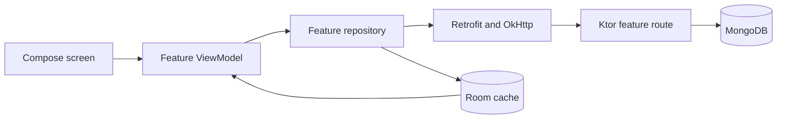

# Data flow

1. Login and registration establish a bearer token and a user ID. Android persists them in encrypted preferences and publishes session state to the dashboard and notifications.
2. Group list and invitation queries are scoped to the authenticated user. Group ledger requests require current membership, and invitation decisions require the recipient.
3. Ledger writes reach Ktor before updating the Android cache. A successful server snapshot replaces the cached entries for that group in one Room transaction, including when the snapshot is empty. Group deletion, invitation acceptance and ledger mutations use MongoDB transactions. Group mutations update the same document to coordinate with membership changes.
4. Room publishes ledger and cached user updates through Flow. Group detail aggregates amounts as decimal values, displays three PKR decimal places, and retains past member history. Splits distribute whole thousandths and preserve the total. Older floating-point documents remain readable.
5. Profile image uploads use same-origin paths. Android resolves local paths against the selected API origin. Render responses use its HTTPS origin, and the server stores the corresponding relative path. A packaged default image supports users without a personal upload.

Hisab uses network-backed group and invitation workflows and a Room read cache. There is no background mutation queue. Profile theme preferences also persist on the device.

Current Android ledger writes include a client entry ID. Replaying the same ID and payload returns the existing document while it is present in the ledger. Conflicting payloads fail. Older clients can still send writes without an ID. After an ambiguous timeout, refresh the ledger before entering the transaction again.
